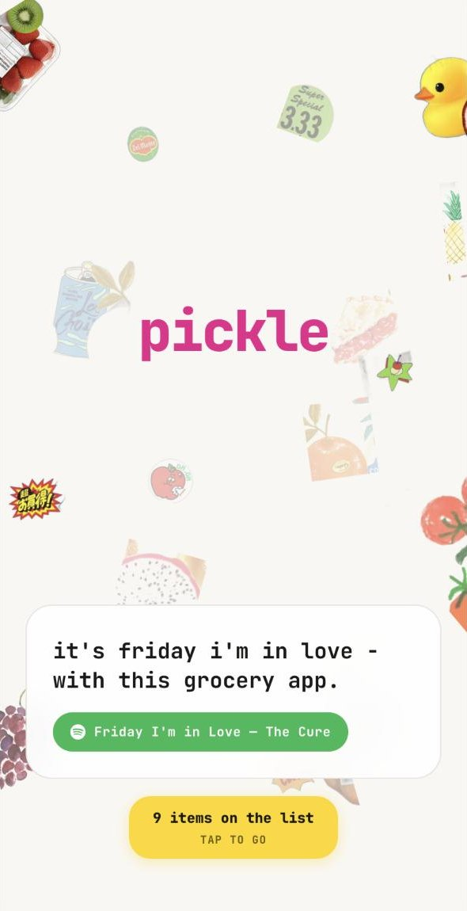
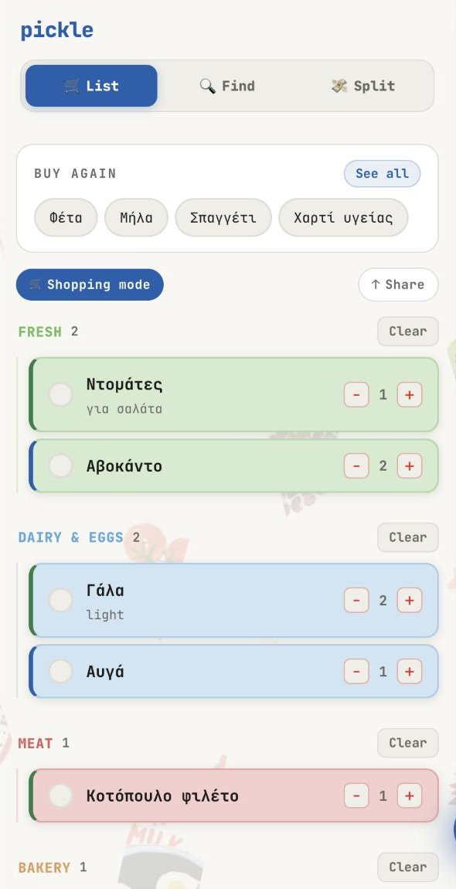
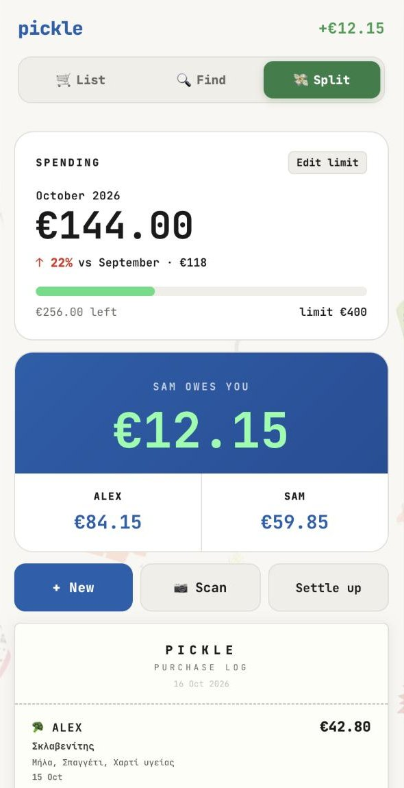

# Pickle

A shared grocery list and expense-splitting app for households. Housemates keep one list, log what they spend, and see where the money goes.

**Live app:** [pickle-list.vercel.app](https://pickle-list.vercel.app). Tap **Try the demo** on the first screen to explore a sample household with a shopping list, expenses and spending history. The demo runs in your browser only and nothing is saved to the server.

<p align="center">
  
  
  
</p>

## Features

- **Shared shopping list** – household members join with a shared code and add items with quantity, notes and category. Items are marked as bought once they're in the basket.
- **Expense splitting** – whoever does the shopping logs the amount, and the app splits shared costs between members and keeps track of balances.
- **Spending analytics** – a breakdown of spending by category (produce, dairy, cleaning, hygiene and more), so the household can see where the budget goes.
- **Monthly push notifications** – at the end of each month, every member gets a notification on their phone with the household's total spend.
- **Receipt scanning** – take a photo of a supermarket receipt and the app reads the store, the total and each item with its category.
- **Monthly budget** – set a spending limit and see how much is left and how this month compares to the last.

## Tech stack

- [Next.js](https://nextjs.org) (App Router) with [React](https://react.dev)
- [TypeScript](https://www.typescriptlang.org)
- [Tailwind CSS](https://tailwindcss.com)
- [PostgreSQL](https://www.postgresql.org) via [Neon](https://neon.tech) (serverless)
- Web Push notifications ([web-push](https://github.com/web-push-libs/web-push))
- Receipt reading with the [Gemini API](https://ai.google.dev)
- Deployed on [Vercel](https://vercel.com)

## Getting started

```bash
git clone https://github.com/bnousi/pickle.git
cd pickle
npm install
```

Create a `.env.local` file in the project root with your Neon database connection string, VAPID keys for push notifications and a Gemini API key for receipt scanning, then start the development server:

```bash
npm run dev
```

Open [http://localhost:3000](http://localhost:3000) in your browser.

## Author

**Barbara Nousi** – [github.com/bnousi](https://github.com/bnousi)
